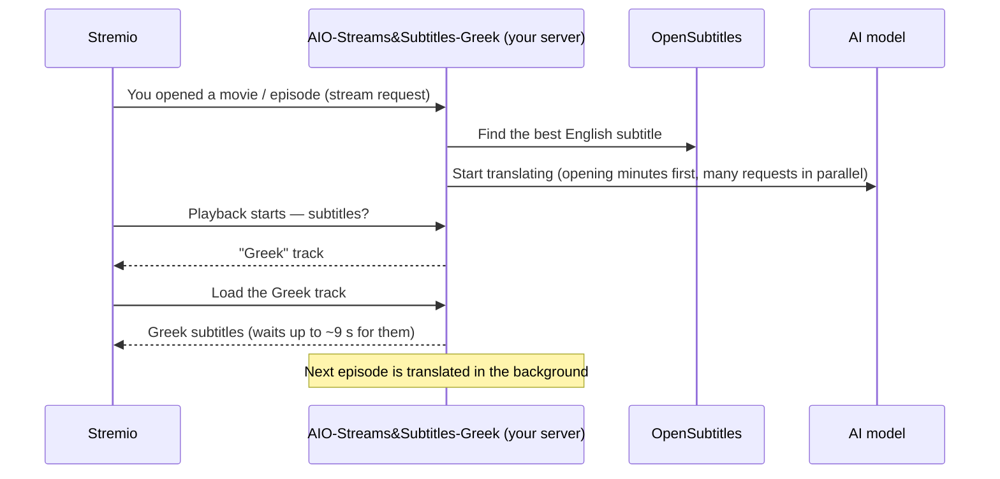

<div align="center">


# AIO-Streams&Subtitles-Greek

**Your own streams + AI-translated Greek subtitles for Stremio — one self-hosted package.**

[](https://github.com/jfle/aio-streams-subtitles-greek/actions/workflows/ci.yml)
[](https://github.com/jfle/aio-streams-subtitles-greek/releases/latest)
[](LICENSE)


</div>

## Standalone editions

- **PolyCue AI** brings OpenSubtitles v3 and local-first AI translation into one Stremio addon. [Open the PolyCue AI branch](https://github.com/jfle/aio-streams-subtitles-greek/tree/polycue-ai)
- **AIOStreams Standalone Installer** deploys the upstream AIOStreams image with its own configuration and data. [Open the AIOStreams branch](https://github.com/jfle/aio-streams-subtitles-greek/tree/aiostreams-standalone)

### Three-add-on setup for movies and series

Use the standalone editions alongside [AIOMetadata](https://github.com/cedya77/aiometadata) to browse mainstream movies and series in Stremio:

| Add-on | Setup |
| --- | --- |
| **AIOMetadata** | Use TMDB for movie and series metadata. Put Netflix Movies and Series first, followed by TMDB Trending and Popular. Add movie and series rows for Prime Video, Disney+, HBO Max, Apple TV+, SkyShowtime, Paramount+, Hulu, and Peacock where relevant. Keep Top Rated and Airing Today for discovery. |
| **AIOStreams** | Set English as the preferred audio language and Greek as the preferred embedded subtitle language. In **Sorting**, rank Cached first, then Language, Subtitle, Resolution, and Quality. Keep language and subtitle preferences soft so releases with incomplete tags still appear. Disable anime-only sources if you only watch mainstream movies and series. |
| **PolyCue AI** | Install it separately for Greek subtitles. Select Greek, use OpenSubtitles v3 first, and enable a local translation fallback if you have a compatible model configured. Set Stremio’s default subtitle language to **Ελληνικά**. |

Fresh installs from the current source offer the [English Movies and TV with Greek Subtitles template](templates/aiostreams-english-greek.json) as the first AIOStreams setup choice. Select it during setup, then add your own stream sources and any service credentials. Upgrading preserves existing AIOStreams settings.

For a separate AIOMetadata instance, download the [mainstream catalog template](templates/aiometadata-mainstream.json), open **Configuration → Import Configuration**, and supply your own TMDB key if the server does not provide one. Import it into a new profile to preserve any existing catalog lineup.

Provider rows are for browsing. Title availability varies by region and playback depends on your configured sources. To verify a new setup, load the catalog rows, play a movie and a series episode, and check that Greek subtitles appear and stay in sync.

This branch documents the bundled v2 release.

One installer sets up two things on your Raspberry Pi, Orange Pi or any Linux box, both behind HTTPS that Stremio accepts — at home and, optionally, away:

| Component | What it does |
|---|---|
| **Greek AI subtitles** (this project) | Finds the English subtitles for whatever you watch, checks they match your release and are in sync, translates them to Greek with the AI you choose, and adds a **Greek** track to the player. |
| **[AIOStreams](https://github.com/Viren070/AIOStreams)** (bundled, optional) | The popular all-in-one stream aggregator: combines stream addons and your debrid service (Real-Debrid, AllDebrid, TorBox…) with filtering and sorting — self-hosted instead of a paid hosted instance. |

Add the subtitle addon inside AIOStreams and Stremio needs **one addon** for streams and Greek subtitles. Prefer subtitles only? Install with `--no-aiostreams`.

Greek is the default; 17 other target languages are available on the configuration page.

<p align="center"></p>

## Features

- **Use the AI you already pay for — no API key needed:**
  - **Sign in with ChatGPT** (Plus / Pro plan)
  - **Sign in with Grok** (SuperGrok / X Premium plan)
  - **Sign in with OpenRouter** (one account for Claude, Gemini, Mistral, DeepSeek, Llama and hundreds more)
- **Or paste an API key** for OpenAI, Anthropic (Claude), Google Gemini, Mistral, DeepSeek, xAI, Groq, OpenRouter or Together AI.
- **Or run it 100% locally** with LM Studio, Ollama, vLLM or any OpenAI-compatible server (e.g. the Greek-tuned *Llama-Krikri-8B*).
- **Fast:** starts translating as soon as you *open* a title, sends many requests in parallel and does the opening minutes first. A 1,000-line episode takes about **1 minute** on a ChatGPT plan.
- **Binge-friendly:** while you watch an episode, the **next episode** is translated in the background, so it starts fully in Greek.
- **The right subtitle, in sync:** matches your exact release (OpenSubtitles hash, release group, source, edition), rejects wrong types (CD parts, forced-only, wrong episode, not English), checks the length, detects **frame-rate** differences (23.976 / 24 / 25 / 29.97 fps) and **aligns** the timing to the best-matching English subtitle — even across different cuts. See [Subtitle matching & sync](#subtitle-matching--sync).
- **Cached:** finished translations are kept on disk for 30 days. Re-watching costs nothing.
- **Private:** your settings are encrypted inside your personal addon link; sign-ins stay on your server.
- **At home and away:** HTTPS on your home network out of the box; one installer option adds an external address (your public IP + a forwarded port, or your own domain), with a password-protected configuration page.
- **AIOStreams included:** installed with Docker, behind the same HTTPS, with a login, weekly automatic updates and outside access — like a hosted instance, on your own hardware.
- **Zero npm dependencies** for the subtitle server, a one-file installer for Debian / Ubuntu / Raspberry Pi OS / Armbian.

## Quick start

> Requirements in short: an always-on Linux machine on your home network (a Pi is perfect) and one AI account. Details: **[REQUIREMENTS.md](REQUIREMENTS.md)**.

**1. Install the server** (on the Pi / Linux box):

```bash
curl -fsSLO https://github.com/jfle/aio-streams-subtitles-greek/releases/latest/download/aio-streams-subtitles-greek-installer.sh
sudo bash aio-streams-subtitles-greek-installer.sh
```

It installs Node.js (and Docker for AIOStreams) if needed, sets up both services and **HTTPS on your home network** (Stremio requires HTTPS), then prints both addresses and the AIOStreams login, e.g.:

- Subtitles: `https://192-168-1-50.local-ip.sh/configure`
- AIOStreams: `https://192-168-1-50.local-ip.sh:8444`

**Away from home too?** Add `--public-ip auto --public-port 8443` and forward ports 8443 (subtitles) and 8444 (AIOStreams) on your router — see [INSTALL.md → Outside your home network](INSTALL.md#outside-your-home-network-public-ip-or-domain).

**Behind CGNAT or without a public IP?** Use a [free Tailscale HTTPS hostname](INSTALL.md#behind-cgnat-with-a-free-https-hostname) without router port forwarding.

**2. Configure:** open that address in a browser on your network, pick a provider, **sign in** (or paste a key), click **Load models**, pick a model and **Test translation**.

**3. Set up AIOStreams:** open its address, sign in with the printed login, add your debrid service and stream addons, and add the subtitle install link (from step 2's **Generate install link**) as a **custom addon**. Save and click **Install** — Stremio now gets streams and Greek subtitles from one addon.

*(Subtitles only: click **Generate install link → Install in Stremio** in step 2 instead.)*

Play anything and choose the **Greek** subtitle track.

Other ways to install (git clone, Docker, Windows/macOS, behind your own domain) and every option are in **[INSTALL.md](INSTALL.md)**.

## How it works



1. When you open a movie or episode, Stremio asks every addon for streams. This addon answers "no streams" but uses the request to start translating that title right away, while you are still picking a stream.
2. When playback starts, Stremio asks for subtitles. The addon finds the English subtitle that best matches your release and offers a **Greek** track pointing back to your server.
3. When the player loads the track, the server waits (Stremio allows about 10 s) until the file is finished — or at least the opening minutes are Greek — and sends it.
4. If the translation is still running, the untranslated lines show in English italics, tagged `[⏳ 42% · OFF/ON για ελληνικά]`. Stremio keeps the first copy it receives, so **turn subtitles OFF and back ON** to load the rest. With a cloud model this is rarely needed.
5. Finished translations are cached, and the next episode of a series is prepared while you watch.

> **Why does the addon fetch the English subtitle itself?** Stremio never tells an addon which subtitle you picked or what other addons returned. So the addon asks the same sources, ranked the same way, which almost always gives the same file. If you use another English subtitle addon, add its URL under **Advanced → English subtitle sources**.

## Subtitle matching & sync

An AI translation is only as good as the English subtitle it starts from — if that file belongs to another release, the Greek one is out of sync too. So every subtitle goes through four layers of checks (on by default, *Translation → Check that the subtitle matches your video*):

| Layer | What it does | Catches |
|---|---|---|
| **1. Fingerprint + type** | Prefers an OpenSubtitles **hash match** for your exact file, then compares release **group, source** (WEB / Blu-ray / HDTV / DVD), **streaming service** and **edition** (Extended, Director's Cut…) with the video's filename. Rejects **CD1/CD2** splits, **forced-only** files, the **wrong season/episode**, episode subtitles on a movie, and files that aren't actually English. | Wrong release, wrong cut, wrong file type |
| **2. Length check** | Compares how long each subtitle runs with the reference subtitle and with the **runtime** from Stremio's catalog. Without a fingerprint, picks the subtitle whose length agrees with the others. | Partial files, other cuts, odd releases |
| **3. Frame rate** | Recognises the **23.976 / 24 / 25 / 29.97 / 30 fps** ratios (e.g. a PAL 25 fps subtitle on a 23.976 fps video drifts 4 % — about 4 minutes by the end of a film) and rescales. | Slowly drifting subtitles |
| **4. Alignment** | Retimes against the best-matching **English reference** using lines both files share as anchors — a constant offset, a frame-rate change, or **elastic per-scene corrections** when scenes were cut (recaps, ads, alternate edits). When the wording differs (a real Greek subtitle against the English reference) it uses **split-aware timing alignment** (3.0, alass-style): it compares *when* lines are on screen, finds the delay and frame rate, and gives each part of the film its own delay when the cuts differ (TV/DVR ad breaks, extended scenes). This also lets the addon **reuse** an existing translation of another release, retimed, instead of translating again. | Offsets, drift, different cuts |

**Real subtitles first (3.0).** The order is: a real subtitle from **OpenSubtitles v3**, retimed to your release → the AI translation (free **local model first** when it is online, then your cloud providers in order). Before using the local model the addon does one quick check of its port and remembers the answer for the session, so a PC that is switched off never slows translations down.

**Which stream gives the best subtitles?** For titles from roughly 2015 on, most subtitles (Greek and English) are timed to **WEB-DL** releases at 23.976 fps; Blu-ray encodes usually share that timing. TV/DVR captures (ad breaks, logos, recaps) and PAL DVD rips (25 fps) often don't match them. For older films, many Greek subtitles were made for DVD rips, so "prefer WEB-DL" isn't automatically right there. The tablet AIOStreams template prefers WEB-DL / BluRay at 1080p and drops cinema recordings, and the retiming above repairs most mismatches that remain.

If a subtitle was retimed you see a short note at the start (e.g. *⏱ Ο συγχρονισμός διορθώθηκε αυτόματα (25 → 23,976 fps)*). If nothing could confirm the release, the note says so and points to the **player's own timing control** — the subtitles menu (**CC** button or **S** key) → **Delay** — which handles any remaining constant offset.

> **Why not align to the embedded subtitles?** Stremio never gives subtitle addons the video or its embedded tracks — only the file's hash, size and name. The reference is therefore the English subtitle that best matches your release (ideally a hash match, which was made from that exact file).

**Why was this subtitle chosen?** Open `https://<your-server>/<your-addon-token>/report/<movie|series>/<id>.json` (the same address as your addon link, with `report/movie/tt0133093.json` instead of `manifest.json`; for an episode: `report/series/tt0944947:1:1.json`). It lists every candidate with its score, reasons, length verdict and why it was accepted or rejected.

## AI providers

| Provider | Sign-in | Notes |
|---|---|---|
| **OpenAI — ChatGPT plan** | ✅ Sign in with ChatGPT | Uses your Plus/Pro plan (24 parallel requests). "luna" models are the fastest. |
| **xAI (Grok)** | ✅ Sign in with Grok, or API key | Uses your SuperGrok / X Premium plan. xAI decides which accounts may use it this way; an API key always works. |
| **OpenRouter** | ✅ Sign in with OpenRouter, or API key | One account for almost every model. Optional spending limit at sign-in. |
| Anthropic (Claude) | API key · or one-click via OpenRouter sign-in | Anthropic doesn't allow Claude subscriptions in other apps. |
| Google Gemini | API key · or one-click via OpenRouter sign-in | Google offers no sign-in for other apps. |
| Mistral, DeepSeek, Groq, Together AI | API key · or one-click via OpenRouter sign-in | |
| OpenAI (API) | API key · or switch to Sign in with ChatGPT | |
| **Local** (LM Studio, Ollama, vLLM…) | — | Free and private. The addon asks LM Studio to switch "thinking" off. See [INSTALL.md → Local models](INSTALL.md#local-models-lm-studio--ollama). |

Small, fast models (luna / Flash / mini / Haiku / "non-reasoning" class) translate subtitles well. A feature film is roughly 1,000–1,500 lines ≈ 60–100k tokens — a few cents on pay-as-you-go models.

### Speed (measured)

| Setup | 1,010-line episode |
|---|---|
| ChatGPT plan, gpt-6.2-sol, 24 parallel | 56 s |
| ChatGPT plan, gpt-6-luna, 24 parallel | ≈ 30 s (estimated: luna answers about 2× faster) |
| Local LM Studio, Llama-Krikri-8B (RTX-class GPU), 4 parallel | ≈ 3.5 min |

## Watching tips

- Choose the subtitle track called **Greek** (the addon offers exactly one).
- If you see English lines tagged `[⏳ …]`, the translation is still running: **subtitles OFF → ON** loads everything translated so far.
- Series: the next episode is ready by the time you get to it.
- The first time you open a title the translation needs a moment; re-watching is instant (cached).

## Privacy & security

- Your configuration (provider, model, and any API key) is **encrypted (AES-256-GCM)** inside your personal addon link with a key that never leaves your server.
- Sign-ins (ChatGPT, Grok, OpenRouter) are stored **only on your server** in `data/credentials/` (owner-only permissions); the addon link carries an opaque reference.
- Anyone who has your full addon link can use your server — and therefore your AI account — so **don't share the link**. Share the project instead.
- Optional `CONFIG_PASSWORD` protects the configuration page — set automatically when you enable outside access, with brute-force throttling. Without a password, configuration requests from outside are refused.

See **[SECURITY.md](SECURITY.md)** for details and how to report a vulnerability.

## Troubleshooting

| Problem | Fix |
|---|---|
| Stremio says **"manifest error"** / can't install | Stremio needs **HTTPS**. Use the installer's `https://…local-ip.sh` address, or see [INSTALL.md → HTTPS](INSTALL.md#https). |
| Subtitles are **in English** | The translation is still running → subtitles **OFF and ON**. If it never changes, open `/status` on your server and check the logs. |
| Subtitles are **out of sync** | Usually no subtitle exists for your exact release (the note at the start says so). Use the player's **subtitles menu → Delay** for a constant offset, or try another stream. The [report](#subtitle-matching--sync) shows what was found. |
| **No Greek track** at all | No English subtitle was found for that title, or the addon isn't installed in this Stremio account. |
| "HTTP 429" / rate limit | Lower **Advanced → Parallel requests**. The addon retries automatically. |
| "Sign-in has expired" | Open the configure page from Stremio (⚙ on the addon) and sign in again. |

More in [INSTALL.md → Troubleshooting](INSTALL.md#troubleshooting).

## Project layout

```
server.js            HTTP server: Stremio addon routes, configure page, sign-in API
src/providers.js     AI provider adapters (OpenAI-compatible, Anthropic, Gemini, ChatGPT plan, Grok plan)
src/translator.js    translation jobs: batching, parallel scheduling, partial results, cache
src/select.js        chooses the English subtitle for the video (scoring, verification, reuse)
src/sync.js          fingerprint, length, frame-rate and alignment checks
src/auth.js          sign-in flows (OpenRouter PKCE, Sign in with ChatGPT, Sign in with Grok device code)
src/config.js        encrypted per-user configuration inside the addon URL
src/subtitles.js     SRT / VTT / ASS / SSA / MicroDVD parsing, SRT writing, encoding detection
public/              configuration page, logo, background
install.sh           installer / updater / uninstaller for Debian-based hosts (incl. bundled AIOStreams)
build-installer.sh   builds the single-file installer (dist/)
test/                zero-dependency test suite with mock providers (npm test)
```

## Development

```bash
git clone https://github.com/jfle/aio-streams-subtitles-greek.git
cd aio-streams-subtitles-greek
npm test            # runs the test suite (Node's built-in test runner, no installs)
npm start           # http://localhost:7000/configure
npm run build       # dist/aio-streams-subtitles-greek-installer.sh
```

Contributions are welcome — see **[CONTRIBUTING.md](CONTRIBUTING.md)**. Version history: **[CHANGELOG.md](CHANGELOG.md)**.

## Disclaimer

This is an independent, community project. It is not affiliated with or endorsed by Stremio, AIOStreams, OpenSubtitles, OpenAI, xAI, OpenRouter, Anthropic, Google or any other provider. AIOStreams is a separate open-source project by Viren070 under its own license; the installer runs its official Docker image unmodified. You are responsible for following the terms of the AI services and subtitle sources you use. AI translations can contain mistakes.

## License

[MIT](LICENSE) © 2026 Ioannis Fletouris
